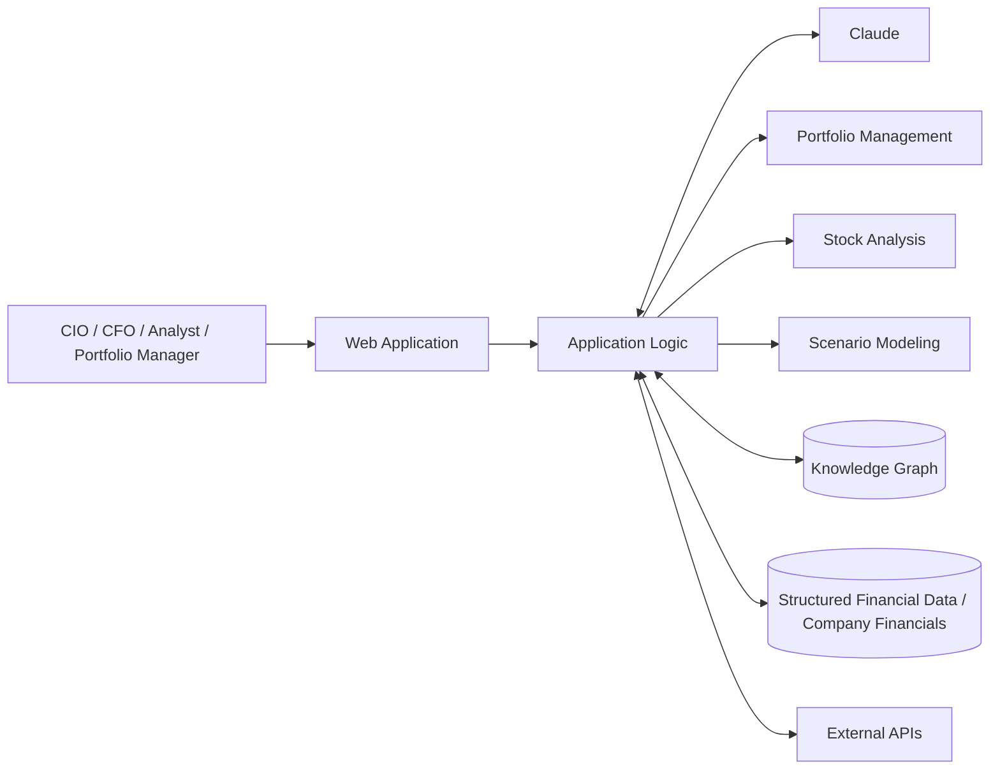

# Enterprise Financial Intelligence Platform

An AI research platform for CIOs, CFOs, analysts and portfolio managers, with Claude reasoning over structured financial data.

> **Note:** This is a client/private project. Source code is not public; this page summarizes the work.

## Overview

The Enterprise Financial Intelligence Platform is an AI-powered research tool for financial decision-makers. It brings portfolio management, stock analysis, company financials, knowledge graphs and scenario modeling together in one place.

The core design goal was to have Claude reason over structured financial data and application logic, so it works as an analytical engine and not as a simple chatbot.

## Key features

- **Portfolio management**: work with portfolio data inside the platform
- **Stock analysis**: AI-assisted analysis of individual stocks
- **Company financials**: access to structured company financial data
- **Knowledge graphs**: relationships between financial entities represented as a graph
- **Scenario modeling**: explore financial scenarios with AI support
- **Claude-driven reasoning**: the LLM reasons over structured data and application logic, not just free-form chat
- **Built for senior finance roles**: designed for CIOs, CFOs, analysts and portfolio managers

## Tech stack

- **LLM:** Claude (Anthropic API)
- **AI:** LLM integration, knowledge graphs
- **Integration:** API integration with financial data sources

## Architecture

## My role

- Developed the AI research platform
- Designed the architecture that lets Claude reason over structured financial data and application logic
- Handled LLM integration, knowledge graph work and API integration

## Screenshots / demo

_Screenshots coming soon. A live walkthrough is available on request._

## Contact

